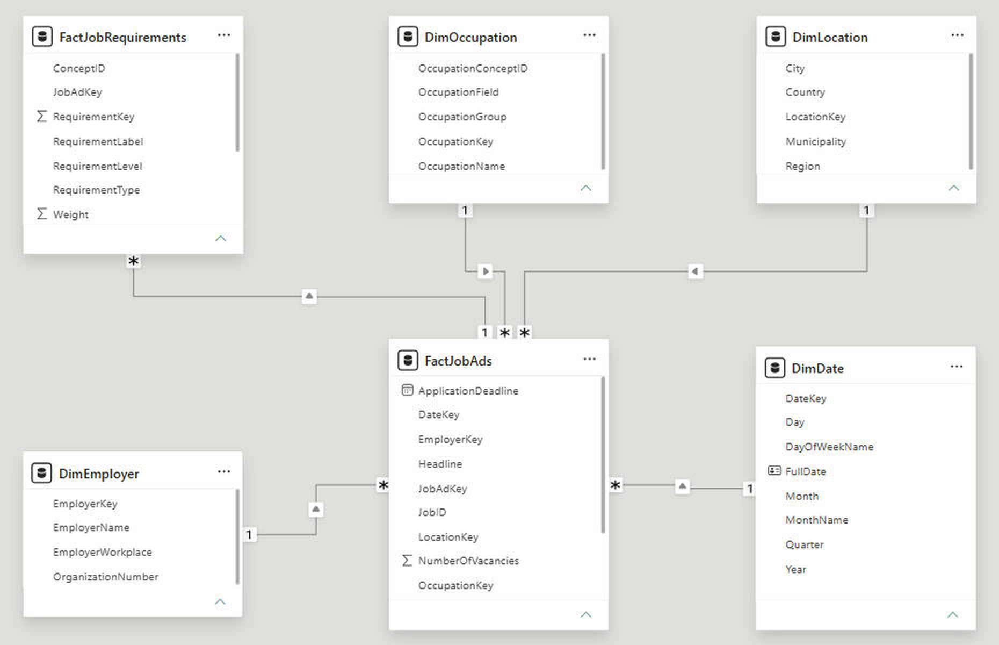

# Swedish Labour Market Intelligence: End-to-End Data Pipeline

An end-to-end BI project on the Swedish job market. Job ads are collected from the public **JobTech JobSearch API** (Arbetsförmedlingen), prepared with Python, loaded by an **SSIS** package into a **SQL Server star schema**, and reported in **Power BI**.

**Status:** complete (extraction → warehouse → ETL → dashboard).


```
JobTech API ──► Python / pandas ──► CSV staging files ──► SQL Server (stg) ──► SSIS ──► SQL Server (dw star schema) ──► Power BI
```

## Key findings (500 live job ads)

- **500 ads, 971 vacancies, 288 employers** hiring.
- **Stockholm holds 28.6% of all ads**, by far the largest region.
- **Staffing and recruitment agencies dominate** the list of top employers.
- **Swedish is the most requested requirement:** 72% of the ads that name a language ask for Swedish.

---

## Stage 1: Extraction and preparation (`01_extract_job.ipynb`)

**Extraction**
- Explored the API response structure (`hits`, `total`) on a small test request before scaling up
- Collected 500 job ads in batches of 100 using offset-based pagination, with `raise_for_status()` so a failed request stops the run
- Saved the untouched API response as a timestamped raw JSON file, so every later step can be traced back to the source

**Flattening nested JSON**
- Flattened each ad with `pd.json_normalize`, giving 90 columns
- Detected the 15 columns that still held lists or dictionaries and kept them out of the main staging table, leaving 75 flat columns

**Normalising requirements**
- Unpacked the nested `must_have` and `nice_to_have` fields (skills, languages, work experience, education, education level) into a separate long-format table: one row per job and requirement
- Result: 327 requirement records covering 171 job ads, each labelled by type and by level (Must Have / Nice to Have)

**Validation**
- Checked job IDs for duplicates: 500 records, 500 unique IDs
- Checked the requirements table for duplicate job–concept–type–level combinations: none found
- Profiled missing values (count and percentage per column) on the core job fields

**Outputs**
| File | Contents |
|---|---|
| `job_ads_source.csv` | One row per job ad (75 columns), the staging table for SQL Server |
| `job_requirements_source.csv` | One row per job requirement (327 rows), the source for a bridge table |
| `job_ads_raw_<timestamp>.json` | Untouched API response |

## Stage 2: SQL Server data warehouse (`sql/`)

[`sql/01_build_warehouse.sql`](sql/01_build_warehouse.sql) builds the `SwedishLabourMarketDW` database:

- **Staging schema (`stg`):** `stg.JobAds` (75 columns) and `stg.JobRequirements`, loaded from the Python CSV outputs. Guard clauses stop the load if staging already holds data, so records can't be inserted twice.
- **Warehouse schema (`dw`), star design:**

| Table | Grain / contents |
|---|---|
| `dw.FactJobAds` | One row per job ad: number of vacancies, headline, application deadline, plus foreign keys to all dimensions |
| `dw.FactJobRequirements` | One row per job ad × requirement (skill, language, experience, education), with type and level (Must Have / Nice to Have) |
| `dw.DimLocation` | Municipality, region, city, country |
| `dw.DimOccupation` | Occupation, occupation group, occupation field (JobTech taxonomy) |
| `dw.DimEmployer` | Employer name, organisation number, workplace |
| `dw.DimDate` | Calendar attributes built from publication dates (DateKey = yyyymmdd) |

- **Data quality in the load:**
  - Text is trimmed, and empty strings become `NULL`.
  - Types are converted with `TRY_CONVERT`.
  - Dimension matching is NULL-safe (`EXISTS … INTERSECT`).
  - The fact load runs in a transaction that rolls back if a job could match more than one dimension row, or if fact and staging row counts differ.
**Data model in Power BI:** FactJobAds sits at the centre with one-to-many, single-direction relationships to the four dimensions. FactJobRequirements is kept at its own grain and linked on JobAdKey, so counts of ads and counts of requirements never inflate each other. Surrogate keys are hidden from report view, DimDate is marked as the date table, and calendar number columns are set to *Don't summarize*.



- [`sql/02_validation_checks.sql`](sql/02_validation_checks.sql) checks row counts per table and missing foreign keys, and runs a few sanity queries (top vacancies, ads requiring Swedish).

## Stage 3: SSIS ETL package (`ssis/`)

The SQL load logic is automated in an SSIS project ([`ssis/SwedishLabourMarket/Package.dtsx`](ssis/SwedishLabourMarket/Package.dtsx)) that runs end to end in this order:

```
Reset_all ─► Job_ads_to_staging ─► Requirements_to_staging ─► DimLocation ─► DimOccupation ─► DimEmployer ─► DimDate ─► Fact_table ─► Requirement
```

- **Reset_all** (Execute SQL Task) clears the facts and dimensions in dependency order, so the package can be re-run safely.
- The **data flow tasks** use OLE DB Source → Derived Column (cleaning) → Sort (remove duplicates) → Lookup (surrogate keys) → OLE DB Destination.
- The connection is `localhost.SwedishLabourMarketDW` with Windows authentication. The repo contains no credentials.

Open `ssis/SwedishLabourMarket.sln` in Visual Studio with the *SQL Server Integration Services Projects* extension.

## Stage 4: Power BI dashboard (`powerbi/`)

[`powerbi/Swedish_Labour_Market.pbix`](powerbi/Swedish_Labour_Market.pbix) connects to the `dw` star schema.

- **KPI cards:** Total Job Ads, Total Vacancies, Employers Hiring, % of language ads requiring Swedish, Stockholm share of ads.
- **Visuals:**
  - Top 10 municipalities
  - Top employers
  - Job ads by occupation field
  - Region table with conditional formatting
  - "What employers ask for": the most requested requirements
- **Slicers:** Region and Occupation field.
- **DAX examples:**
```DAX
Total Job Ads      = COUNTROWS ( FactJobAds )
Total Vacancies    = SUM ( FactJobAds[NumberOfVacancies] )
Employers Hiring   = COUNTROWS ( SUMMARIZE ( FactJobAds, DimEmployer[OrganizationNumber] ) )
Ads Mentioning     = DISTINCTCOUNT ( FactJobRequirements[JobAdKey] )
Stockholm Share of Ads =
    DIVIDE (
        CALCULATE ( [Total Job Ads], DimLocation[Region] = "Stockholms län" ),
        CALCULATE ( [Total Job Ads], ALL ( DimLocation ) )
    )
```
**Model metadata:** the semantic model documents itself, so anyone opening it can see what each number means without asking.

- **Descriptions** on every measure and table, shown as a tooltip in the Data pane (for example, the Stockholm share notes that its denominator ignores location filters, so it is always the national total).
- **Display folders** group the measures into *Volume*, *Requirements* and *Shares*.
- **Format strings** set once in the model: counts as `#,0`, percentages as `0.0%`, so every visual shows them the same way.
- **Data categories** on the location columns (City, Country/Region, Place for municipality, County for län), so map visuals geocode them correctly.


## Repository structure

```
├── 01_extract_job.ipynb             Stage 1 – API extraction, flattening, validation
├── job_ads_source.csv               staging file: one row per job ad
├── job_requirements_source.csv      staging file: one row per job requirement
├── requirements.txt
├── sql/
│   ├── 01_build_warehouse.sql       Stage 2 – database, staging, star schema, loads
│   └── 02_validation_checks.sql     row counts and key checks
├── ssis/
│   ├── SwedishLabourMarket.sln
│   └── SwedishLabourMarket/         Stage 3 – SSIS project (Package.dtsx …)
└── powerbi/
    ├── Swedish_Labour_Market.pbix   Stage 4 – dashboard
    ├── dashboard.jpg
    └── data-model.png
```

## How to run

1. **Extract:** Python 3.10+, no API key needed.
   ```bash
   pip install -r requirements.txt
   jupyter notebook 01_extract_job.ipynb
   ```
   The API returns the ads that are live when you run it, so each run collects a different set of 500 ads.
2. **Warehouse:** in SQL Server Management Studio, import the two CSVs as `dbo.job_ads_source` and `dbo.job_requirements_source`, then run `sql/01_build_warehouse.sql`.
3. **ETL:** open the SSIS solution and run `Package.dtsx` to reload staging, dimensions and facts.
4. **Report:** open the `.pbix` in Power BI Desktop, point it at your SQL Server instance, and refresh.

## Tools
Python · pandas · requests · Jupyter · SQL Server · T-SQL · SSIS · Power BI · DAX

---
**Author:** Chidinma Laura Ikwechegh, BI & Data Analyst, Stockholm
[Portfolio](https://laurascodes.github.io/Portfolio/) · [LinkedIn](https://www.linkedin.com/in/chidinma-laura-ikwechegh-4619a311b/)
